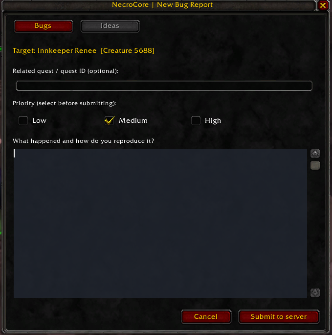
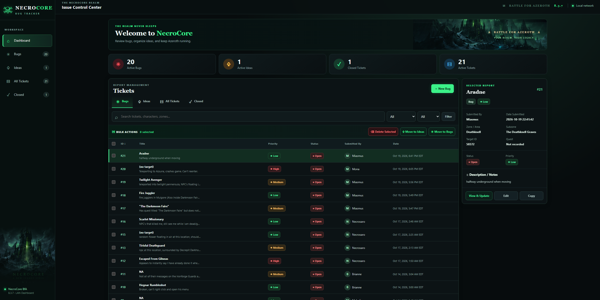
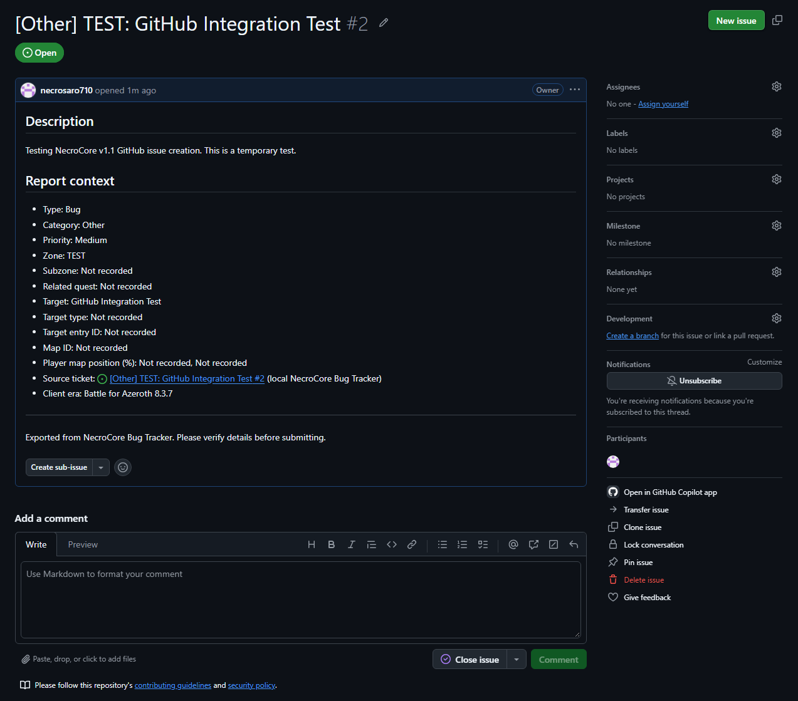

# NecroCore Bug Tracker — Community Edition

A self-hosted in-game **bug and idea tracker** for compatible World of Warcraft **Battle for Azeroth 8.3.7** private servers. It consists of a WoW Lua addon, C++ worldserver chat bridge, and Python web dashboard.

**[⬇ Download latest v1.1 source (GitHub ZIP)](https://github.com/necrosaro710/NecroCore-BugTracker/archive/refs/heads/main.zip)** — includes the GitHub issue exporter and dashboard updater. Extract the whole archive before running the scripts.

**[Download the original v1.0 release](https://github.com/necrosaro710/NecroCore-BugTracker/releases/tag/1.0)**

**Installation guide:** [README_START_HERE.md](README_START_HERE.md) — setup, build instructions, data locations and upgrades.

## Screenshots

### GitHub issue export — tested with v1.1

The dashboard successfully prepared a full GitHub issue from a local ticket, including its category, description, priority, and report context. This is an actual test report submitted through the v1.1 GitHub export workflow.

[View the actual test issue (#2)](https://github.com/necrosaro710/NecroCore-BugTracker/issues/2).

## GitHub issue review (v1.1)

Review a gameplay ticket, generate a standardized issue title such as `[Quest] Westfall: Treasure Hunting`, and open a **prefilled GitHub draft** in the game server's repository. You approve and submit it on GitHub yourself; the tracker then lets you attach the resulting issue URL to the original ticket. Reporter identity is excluded by default. See [GitHub export instructions](docs/GITHUB_ISSUES.md).

For existing installs, use `06_Update_Existing_Dashboard_v1.1.cmd` from a separately extracted v1.1 ZIP (stop the running dashboard first). No worldserver rebuild or addon reinstall.

## Quick start

1. Download the [source ZIP](../../archive/refs/heads/main.zip) or GitHub release, and **extract everything**.
2. Run `01_Setup_Dashboard.cmd` and then `02_Start_Dashboard.cmd`. The local dashboard defaults to `127.0.0.1:8088`.
3. On a compatible core source tree, run `03_Install_Server_Source.cmd`, reconfigure CMake, **rebuild worldserver**, and set `NECROBUG_INBOX` to match the absolute dashboard incoming-log path.
4. Install the client Lua addon with `04_Install_Client_Addon.cmd`, log in, and try `/bug` and `/idea`.

**Warning:** Web dashboard is for the local machine or a **trusted private LAN**, not public internet hosting. Do not expose the web port or publish private `web/config.json`, `bugs.sqlite3`, or report logs. Use a dedicated test server first; only one BfA 8.3.7-derived core implementation has been verified.

Licensed original source: GPL-3.0-or-later, with upstream license notices preserved. Not affiliated with Blizzard Entertainment. Contributions/issues are welcome on a **best-effort** basis; update and response times are not guaranteed.

Official project: https://github.com/necrosaro710/NecroCore-BugTracker

Check out HavenWoW Battle For Azeroth 8.3.7 for the best BfA content fixes!  https://github.com/HavenWoW/BFA-HavenCore
